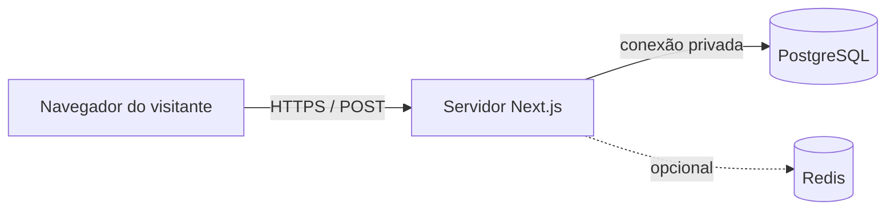

# Formulários, PostgreSQL local e Redis local

Especificação opcional para implementação posterior. Nenhum banco ou endpoint foi criado. Nenhum dado de visitante foi coletado. Tecnologias citadas foram solicitadas pelo usuário; driver, ORM, hospedagem, CRM e serviço de mensagens não foram selecionados.

## 1. Resposta à viabilidade

Sim. Um formulário pode enviar dados ao backend Next.js, que valida e registra o envio em um PostgreSQL local. Esse caminho serve para solicitações de informações sobre aulas, interesse em grupo/individual e contatos de atendimento. Registro de interesse não representa matrícula efetuada. A documentação do PostgreSQL descreve inserções e confirmação de alterações por transações. [INSERT](https://www.postgresql.org/docs/current/sql-insert.html), [Transações](https://www.postgresql.org/docs/current/tutorial-transactions.html).

Redis também armazena dados e pode persistir em disco com RDB/AOF, mas a durabilidade depende da configuração e há diferenças nas janelas de perda. Minha recomendação para este projeto é PostgreSQL como registro principal e Redis opcional para estados temporários, limitação de envios ou cache. Redis não é necessário para começar. [Persistência Redis](https://redis.io/docs/latest/operate/oss_and_stack/management/persistence/).

## 2. O que “local” significa



No desenvolvimento atual, Next.js e PostgreSQL podem rodar no computador do projeto. Em produção, o servidor Next.js deve conseguir alcançar o banco em uma rede privada. “Local” pode ser o próprio servidor de hospedagem. Um banco somente no computador pessoal, desligado ou inacessível pela aplicação publicada, não recebe os formulários do site público.

`localhost` no navegador aponta para o computador do visitante; `localhost` no backend aponta para o ambiente onde o backend roda. Dentro de um container, aponta para aquele container. Não configurar o frontend para conectar diretamente à porta do banco. Não abrir PostgreSQL/Redis à internet como solução para esse acesso.

Um site exportado como arquivos estáticos precisa de um backend separado para persistir envios. A aplicação Next.js com runtime de servidor pode hospedar seu próprio Route Handler. A versão instalada tem documentação em `node_modules/next/dist/docs/01-app/01-getting-started/15-route-handlers.md`; conferir novamente na execução. [Documentação oficial de Route Handlers](https://nextjs.org/docs/app/getting-started/route-handlers).

## 3. Escopo de um primeiro formulário

Local: página Contato, com links contextuais das ofertas. Acesso direto ao WhatsApp permanece disponível. Formulário usa os tokens de input/erro/sucesso já definidos, sem acrescentar uma nova identidade.

| Campo | Regra proposta |
|---|---|
| Nome | Obrigatório, 2–120 caracteres após trim |
| WhatsApp/telefone | Obrigatório, normalizado com código do país; 8–15 dígitos após normalização |
| E-mail | Opcional, até 254 caracteres e validação de formato quando presente |
| Motivo | `new_student` ou `student_support` |
| Formato de interesse | `group`, `individual` ou `undecided`; somente para novo interessado |
| Mensagem | Opcional, até 2000 caracteres |
| Página de origem | Pathname do site, validado em uma lista permitida |

Não pedir CPF, data de nascimento, endereço, documentos, dados de pagamento ou upload neste primeiro contato. Não coletar automaticamente URL completa com parâmetros, IP permanente ou dados adicionais para preencher um CRM futuro. O aviso de tratamento e as decisões de público/retensão pertencem ao responsável da escola.

## 4. Contrato do endpoint proposto

Arquivo futuro: `src/app/api/contact/route.ts`, `POST /api/contact`, runtime Node.js. Não usar runtime Edge para um driver incompatível. Aceitar apenas JSON nesta primeira versão; o frontend é uma ilha cliente e possui fallback de contato por WhatsApp quando JavaScript não estiver disponível. Não prometer envio nativo completo sem JavaScript nesta fase.

```json
{
  "name": "Nome do visitante",
  "phone": "+55...",
  "email": null,
  "kind": "new_student",
  "interest": "group",
  "message": "Gostaria de consultar os horários.",
  "sourcePath": "/cursos/ingles-em-grupo",
  "idempotencyKey": "UUID-gerado-para-este-envio"
}
```

Exemplo documental, não dado real ou payload já enviado. A origem identifica o contexto; não comprova que a pessoa realmente visitou a página e não é uma decisão de autorização.

| Resposta | Significado |
|---|---|
| `201` `{ "ok": true, "reference": "UUID" }` | Novo envio confirmado no banco |
| `200` com a mesma referência | Repetição do mesmo envio já confirmado |
| `400` `INVALID_INPUT` | Campos inválidos; indicar erros por nome de campo |
| `403` `ORIGIN_NOT_ALLOWED` | Origem não permitida |
| `409` `IDEMPOTENCY_CONFLICT` | Mesma chave, conteúdo diferente |
| `413` `BODY_TOO_LARGE` | Mais de 16 KiB efetivos de body |
| `415` `UNSUPPORTED_MEDIA_TYPE` | Tipo diferente de application/json |
| `429` `RATE_LIMITED` | Excesso de envios; incluir Retry-After |
| `503` `UNAVAILABLE` | Persistência ou proteção crítica indisponível; sem sucesso fictício |

Sem GET público listando contatos e sem atualização/exclusão públicas. Não retornar payload pessoal, detalhes SQL, credenciais ou stack trace. Usar mensagens legíveis e um identificador de erro operacional que não contenha dados pessoais.

## 5. Persistência e idempotência

Modelo conceitual, a converter em migração na fase de execução:

| Registro `contact_requests` | Tipo / restrição |
|---|---|
| `id` | UUID, chave primária, gerado no servidor |
| `idempotency_key` | UUID, obrigatório e único |
| `name` | Texto com limite aprovado |
| `phone_normalized` | Texto com telefone normalizado |
| `email` | Texto opcional |
| `kind`, `interest` | Valores permitidos pelo contrato; interest ausente no suporte |
| `message` | Texto opcional limitado |
| `source_path` | Pathname permitido |
| `status` | Inicial `new`; estados de atendimento futuros `contacted` e `closed` somente por acesso restrito |
| `created_at`, `updated_at` | Timestamp com fuso, armazenado em UTC |
| `notice_version` | Versão do aviso aprovado exibido no envio |

Não tornar telefone/e-mail únicos: uma pessoa pode voltar a entrar em contato e um telefone pode ser compartilhado. A chave de idempotência diferencia retransmissão do mesmo envio de um contato novo legítimo.

O frontend mantém a mesma chave durante uma tentativa e seus retries; alteração dos dados ou novo envio após sucesso gera outra chave. O backend compara o conteúdo normalizado quando a chave já existe e nunca sobrescreve um envio diferente. A restrição única no banco evita duplicatas mesmo com requisições concorrentes.

Se houver um registro de evento `request_received`, gravá-lo na mesma transação da solicitação. Retornar sucesso somente após commit. Nenhuma notificação a terceiro faz parte dessa transação ou deste escopo.

Índices iniciais: chave única de idempotência; consulta operacional por status/data; não criar índice para cada campo por hábito. Conteúdo editorial continua em arquivos tipados, separado dos registros pessoais.

## 6. Proteções e estados

- Validar os dados no servidor, ainda que o frontend valide; reaproveitar Zod já instalado quando compatível.
- Limitar a leitura efetiva do body a 16 KiB; não confiar apenas em Content-Length.
- Lista explícita de origens permitidas, definida no backend. Não usar Host arbitrário como autorização e não habilitar CORS amplo.
- Consultas parametrizadas; sem concatenar campos em SQL. Banco e credenciais somente no servidor, sem prefixo NEXT_PUBLIC.
- Proposta inicial de limitação: dez tentativas por dez minutos por chave técnica pseudonimizada. Deve contar inclusive tentativas inválidas e funcionar com concorrência. Ajustar mediante observação operacional, não como regra comercial.
- Pode usar contadores com expiração no PostgreSQL inicialmente. Se Redis for adotado para isso, incremento/expiração devem ser atômicos; tratar indisponibilidade sem liberar abuso silenciosamente. Na ausência de proteção crítica/fallback verificado, responder 503 e preservar dados digitados.
- Chave de limitação derivada no servidor, com segredo próprio, da origem técnica confiável de rede. Não confiar cegamente em X-Forwarded-For; expirar o contador. Não guardar IP permanente na solicitação.
- Não registrar nomes, telefones, e-mails ou mensagens em logs de sucesso/erro. Usar ID e resultado operacional.
- Separar papel da aplicação, papel de migração e acesso de atendimento. Permissões somente nas tabelas e operações necessárias; aplicação não precisa ser superusuário.

Estados visuais: pronto, enviando, confirmado, erro por campo, indisponível e excesso de envios. Loading mantém largura do botão. Falhas mantêm os campos; nenhuma limpeza antes da confirmação. Confirmado significa “solicitação registrada”, não “mensagem enviada no WhatsApp” ou “matrícula concluída”. Não afirmar prazo de resposta sem confirmação da escola.

## 7. PostgreSQL e Redis: decisão proposta

| Necessidade | PostgreSQL | Redis |
|---|---|---|
| Histórico de contatos e acompanhamento | Registro principal proposto | Não será o único registro deste projeto |
| Consultas por data, status e origem | Adequado ao modelo relacional | Possível com outro desenho; sem necessidade inicial |
| Contadores temporários e expiração | Pode atender o MVP | Opção de apoio com TTL |
| Recuperação de dados | Backup e restauração operacional | Persistência/configuração e backup próprios |
| Primeira implementação | Suficiente, sem obrigar Redis | Opcional |

Redis possui expiração de chaves e estratégias de persistência; expiração de contador não é retenção do cadastro. [EXPIRE](https://redis.io/docs/latest/commands/expire/), [Persistência](https://redis.io/docs/latest/operate/oss_and_stack/management/persistence/).

## 8. Operação e tratamento de dados

Antes de captação pública, definir quem atende, como consulta os registros de forma restrita, finalidades, aviso, retenção, procedimento de exclusão e acesso autorizado. Uma tela administrativa é um escopo próprio; não surge automaticamente porque existe uma tabela. Uma rotina restrita já existente pode atender o início, desde que responsável e acesso estejam definidos.

Autorização de marketing é uma finalidade separada e fica fora do MVP. Não assumir que um checkbox genérico resolve todo tratamento. Dados institucionais e texto de privacidade precisam ser aprovados pelo responsável competente. A orientação de segurança da ANPD é referência para acesso, proteção e operação, não um texto de política pronto para copiar. [Guia da ANPD](https://www.gov.br/anpd/pt-br/centrais-de-conteudo/materiais-educativos-e-publicacoes/guia-orientativo-sobre-seguranca-da-informacao-para-agentes-de-tratamento-de-pequeno-porte).

Backup não basta sem restauração testada. Definir periodicidade e destinos protegidos conforme operação; testar recuperação em outro banco e registrar a evidência. Retenção e exclusão também precisam considerar backups e seus acessos. [Backup lógico PostgreSQL](https://www.postgresql.org/docs/current/backup-dump.html).

## 9. Configuração futura, sem valores secretos

`DATABASE_URL`, `CONTACT_FORM_ENABLED`, `CONTACT_ALLOWED_ORIGINS`, `CONTACT_LIMIT_SECRET`, versão do aviso e parâmetros operacionais pertencem à configuração do servidor. `REDIS_URL` só entra se o apoio Redis for escolhido. Um `.env.example` futuro usa placeholders, nunca credenciais reais; `.env.local` fica fora do pacote e de controle de versão.

Driver e eventual ferramenta operacional devem ser consultados no acervo O Setup antes de seleção/instalação. As operações setup-agent não estão expostas nesta sessão; o histórico registra autenticação pendente. Não se presume ausência de recurso adequado. Não instalar PostgreSQL, Redis, containers, drivers, ORM ou criar migrações nesta entrega documental.

## 10. Critérios da fase de backend

1. Persistência continua após reiniciar a aplicação/banco, conforme a configuração verificada.
2. Retry e envio concorrente com a mesma chave deixam uma só solicitação; payload diferente não sobrescreve.
3. Dados inválidos/body excessivo/origem proibida não são gravados.
4. Banco indisponível não produz sucesso; UI preserva os campos e oferece o WhatsApp.
5. Limitação de envios funciona sob concorrência e tem política de falha definida.
6. Credenciais ficam fora do bundle/log; registros não são acessíveis publicamente.
7. Um responsável consegue consultar os registros por acesso restrito e realizar atendimento.
8. Backup/restauração e as decisões de tratamento estão preparados antes da ativação pública.

O site institucional pode ser implementado primeiro e funcionar com WhatsApp. A captação persistente pode ser acrescentada depois, com PostgreSQL e a operação correspondente.
